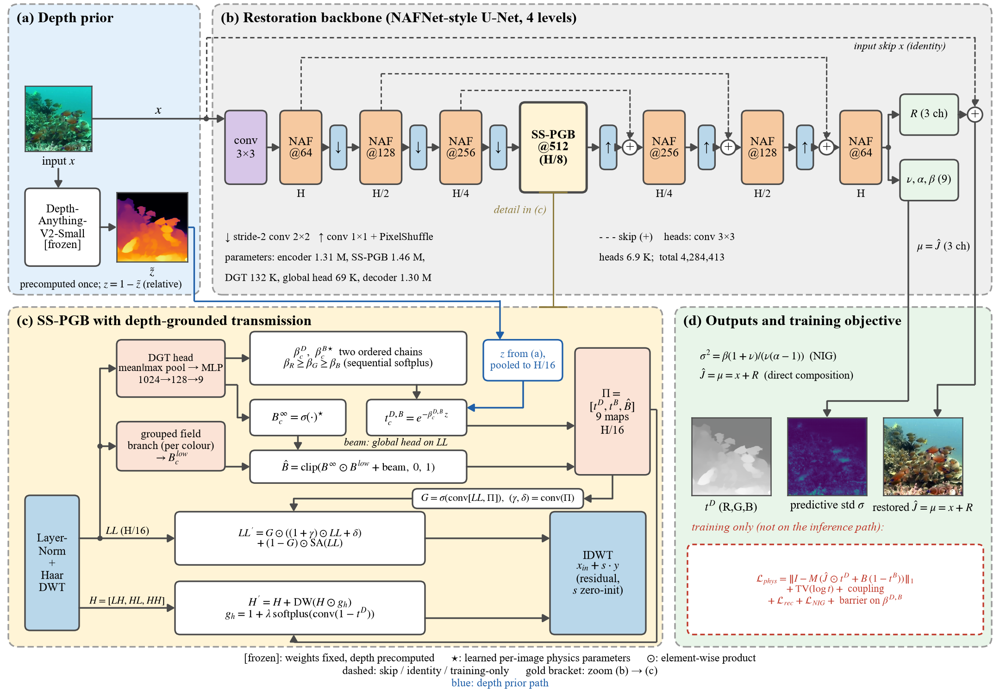
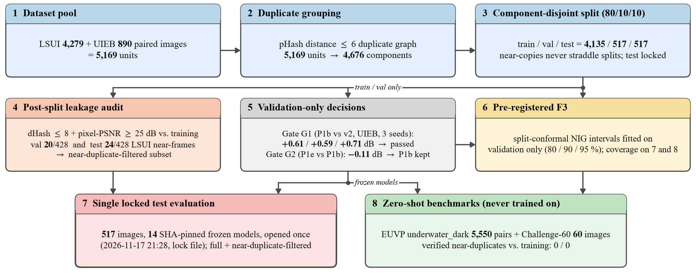
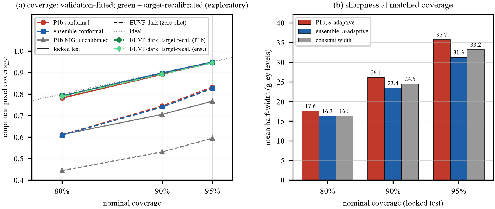
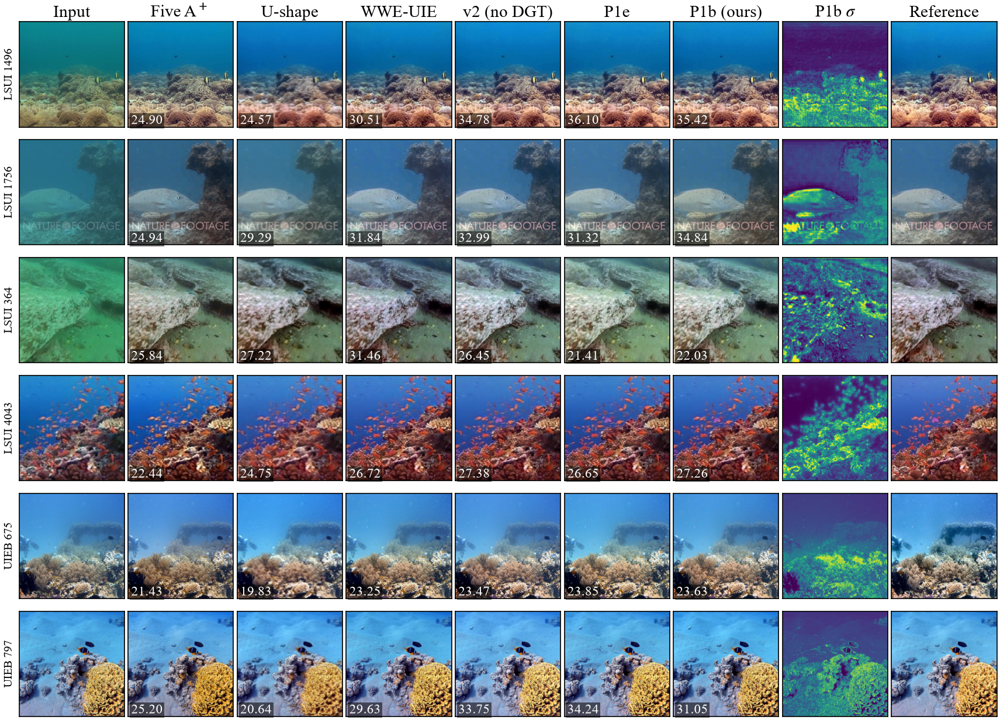

# Depth-Conditioned Wavelet Restoration with Split-Conformal Uncertainty for Underwater Image Enhancement

Underwater images lose red light with distance, blur through scattering, and carry a veiling haze from suspended
particles. Learned enhancement networks are usually scored once, on benchmark splits that can share near-duplicate
frames with the training data, and they output a single image with no indication of which pixels can be trusted.

This repository contains the code, data splits, aggregated results and figure scripts for a network that
addresses both issues:

- **Model (P1b, 4.28 M parameters).** A NAFNet-style U-Net with a Haar-wavelet bottleneck block (SS-PGB). The
  bottleneck's low- and high-frequency bands are conditioned on per-image transmission maps. These are computed
  from a frozen **Depth-Anything-V2-Small** depth prior through two channel-ordered attenuation chains, one for the
  direct signal and one for backscatter. A **Normal-Inverse-Gamma (NIG)** head outputs a per-pixel predictive spread.
- **Calibrated pixel intervals.** Split-conformal calibration on the validation split turns the spread into
  intervals. They cover **89.2%** of test pixels at the 90% level, against 70.5% for the uncalibrated head. On a
  zero-shot water type, coverage drops to 74.4%; recalibrating on **500** target images restores **89.4%**.
- **Leakage-controlled evaluation.** LSUI and UIEB are split by **4,676 duplicate-connected components** (SHA-256
  and perceptual-hash links). The test split was opened once for point metrics, behind a lock file. Gates and
  claims were pre-registered, and a near-duplicate-filtered test subset (493 images) is reported alongside the
  full split.


*Figure 1. Architecture. (a) Frozen depth prior. (b) U-Net with the SS-PGB bottleneck; the output is the input
plus a predicted residual. (c) SS-PGB: a Haar DWT splits features into low and high bands, and the
depth-grounded transmission maps gate the low band and set the high-band gain. (d) Outputs (restored image,
predictive spread) and the training objective.*

## Evaluation protocol


*Figure 2. Leakage-controlled protocol: duplicate-connected components and component-disjoint 80/10/10 splits,
pre-registered gates on validation, a single locked test opening with a planted-fault parity check, and
zero-shot sets that no model was trained on.*

## Results

### Locked in-domain test (517 images; filtered subset 493)

| Model | Params | PSNR | PSNR (493) | SSIM | LPIPS ↓ | ΔPSNR vs. P1b [95% CI] |
|---|---|---|---|---|---|---|
| **P1b (ours)** | 4.28 M | **27.186** | 27.075 | **0.9152** | **0.1115** | — |
| WWE-UIE (retrained) | 0.73 M | 26.491 | 26.418 | 0.9082 | 0.1227 | −0.69 [−0.96, −0.45] |
| U-shape (retrained) | 31.59 M | 23.695 | 23.661 | 0.7890 | 0.3647 | −3.49 [−3.87, −3.12] |
| Five A+ (retrained) | 0.009 M | 23.433 | 23.476 | 0.8837 | 0.1846 | −3.75 [−4.14, −3.39] |

Notes:
- All baselines were retrained on the same split with the same recipe.
- Three seeds of P1b give 27.230 ± 0.086 dB.
- Intervals are paired bootstrap 95% CIs (B = 2000), stratified by dataset.

### Zero-shot: EUVP underwater_dark (5,550 pairs)

| Model | PSNR | SSIM | LPIPS ↓ | ΔPSNR (P1b − model) [95% CI] |
|---|---|---|---|---|
| **P1b (ours)** | **20.015** | **0.8826** | **0.2615** | — |
| WWE-UIE (retrained) | 19.878 | 0.8794 | 0.2683 | +0.14 [+0.10, +0.17] |
| MARINE-Net (published checkpoint) | 19.660 | 0.8682 | 0.2621 | +0.35 [+0.31, +0.40] |
| PhaseFormer-UIEB (published checkpoint) | 18.566 | 0.8580 | 0.2936 | +1.45 [+1.39, +1.51] |

The full table, including Challenge-60 no-reference metrics, is in [`docs/master_tables.md`](docs/master_tables.md).

### Split-conformal pixel intervals (P1b; calibrated on the 517 validation images)

| Set | Nominal | Coverage | Mean half-width (grey levels) | Uncalibrated NIG coverage |
|---|---|---|---|---|
| Locked test | 80% | 0.782 | 17.6 | 0.612 |
| Locked test | 90% | 0.892 | 26.1 | 0.705 |
| Locked test | 95% | 0.948 | 35.7 | 0.767 |
| EUVP-dark (zero-shot) | 90% | 0.744 | 30.6 | 0.531 |
| EUVP-dark, recalibrated on 500 images* | 90% | 0.894 | 55.5 | — |

\*Exploratory analysis: quantiles re-fitted on 500 EUVP-dark images and evaluated on the disjoint 5,050.


*Figure 3. (a) Empirical vs. nominal pixel coverage on the locked test and on EUVP underwater_dark, for the
conformal intervals (single model and three-seed ensemble) and the uncalibrated NIG reading; green curves show
target-domain recalibration. (b) Interval half-width at matched coverage.*


*Figure 4. Six locked-test images drawn before any output existed: input, retrained baselines, ablations,
P1b, P1b's predictive spread and the reference, with per-tile PSNR.*

Zero-shot examples (EUVP underwater_dark and Challenge-60): [`assets/fig7_qualitative_zeroshot.png`](assets/fig7_qualitative_zeroshot.png).

### What did not work

These negative results are reported deliberately:
- **The DGT gain did not replicate.** The depth-grounded transmission branch passed its pre-registered validation
  gate in all three seeds (+0.59 to +0.71 dB on UIEB). On the locked test the gain was +0.09 to +0.41 dB, with
  every interval including zero.
- **No component ablation is significant.** All ablations (no transmission branch, no physical field, no
  re-rendering loss, no NIG head) lie within ±0.15 dB on test.
- **The spread tracks texture, not colour casts.** It does not flag global colour-cast errors; on the worst
  zero-shot failures it is anti-correlated with the error.
- **The depth prior costs speed.** It halves end-to-end throughput, from 64.8 to 30.6 FPS at 256×256 on an RTX 3070.

## Repository structure

```
src/
  models/            ss_pgn.py (P1b, P1e, v2, v1 via config), dgt_head.py, post_hoc_head.py, ...
  training/          train.py, losses_sspgn.py
  validation/        metrics, UIQM/UCIQE, conformal utilities
  data/              build_splits.py, precompute_depth.py, scene-feature scripts (P1e)
  diagnostics/       evaluation runners: locked test (phase_f_test.py), zero-shot (phase_e_eval.py),
                     conformal (f3_conformal.py, f3_analyze.py, f3_target_recal.py), efficiency, audits
  utils/
baselines/
  adapters/          wrappers and the shared training recipe for U-shape, Five A+, WWE-UIE
  README.md          upstream repositories and pinned commits
scripts/
  figures/           figure generators (read only the tracked result files)
  tables/            build_master_tables.py -> docs/master_tables.md
  diagnostics/       downstream feature check, learned-coefficient dump, saved-output metrics
  verify_checkpoints.py
data/splits/lsui_uieb_all_d6_seed0/
  train_manifest.txt (4,135)  val_manifest.txt (517)  test_manifest.txt (517)
  test_dedup_manifest.txt (493)  components.csv  split_summary.json
reports/experiments/ aggregated per-image CSVs and summary JSONs behind every number
reports/integrity_audit/ duplicate-overlap audit of the evaluation sets
protocols/preregistrations.md
checkpoints_sha256.json / checkpoints_sha256.txt
assets/              preview figures for this README
```

## Setup

```bash
python -m venv .venv && source .venv/bin/activate        # Windows: .venv\Scripts\activate
pip install torch==2.7.1 torchvision==0.22.1 --index-url https://download.pytorch.org/whl/cu118
pip install -r requirements.txt
```

### Datasets

The datasets are not redistributed. Download them from their official sources and place them as follows:

```
data/raw/
  LSUI/input/  LSUI/GT/
  UIEB/raw_images/  UIEB/reference_images/  UIEB/challenge_60/
  EUVP/Paired/underwater_dark/trainA/  EUVP/Paired/underwater_dark/trainB/
```

The manifests in `data/splits/` use these repository-relative paths. `components.csv` records each image's
duplicate component, so you can check that no component crosses splits.

### Checkpoints

The trained weights (`.pth`) are **not included** in this repository because of their size. They are available
from the author on request. Place each file at the path listed in `checkpoints_sha256.json`, then verify it:

```bash
python scripts/verify_checkpoints.py
```

## Usage

1. **Precompute depth** (frozen Depth-Anything-V2-Small, fp16):
   ```bash
   python src/data/precompute_depth.py --splits train val
   ```
2. **Train P1b** (100k steps, AdamW, 256×256 crops, effective batch 8). Use `--seed 1` or `--seed 2` for the
   replicates; drop `--dgt --dgt-ordered` to train v2:
   ```bash
   python src/training/train.py --arch baseline --compose direct --phys-conditioning v2 --dgt --dgt-ordered \
       --seed 0 --out runs/phase1/P1b_v2_dgt_ordered
   ```
3. **Retrain a baseline** with the same recipe. Clone the upstream repository into `baselines/repos/` at the
   commit listed in `baselines/README.md`, then run:
   ```bash
   python baselines/adapters/train_baseline.py --name wweuie       # or ushape, fiveaplus
   ```
4. **Validation evaluation and conformal calibration:**
   ```bash
   python src/diagnostics/phase_f_test.py --split val
   python src/diagnostics/f3_conformal.py --split val
   python src/diagnostics/f3_conformal.py --split dark
   python src/diagnostics/f3_analyze.py
   python src/diagnostics/f3_target_recal.py       # exploratory target-domain recalibration
   ```
5. **Locked test evaluation.** This runs once: the script writes a lock file under `runs/phase_f/` and refuses a
   second run.
   ```bash
   python src/diagnostics/phase_f_test.py --split test --confirm-single-opening
   python src/diagnostics/f3_conformal.py --split test --confirm-f3
   ```
6. **Zero-shot evaluation** (EUVP underwater_dark, Challenge-60):
   ```bash
   python src/diagnostics/phase_e_eval.py
   ```
7. **Regenerate the tables and the figures** that depend only on `reports/experiments/`:
   ```bash
   python scripts/tables/build_master_tables.py
   python scripts/figures/fig2_protocol.py
   python scripts/figures/fig3_reliability.py
   python scripts/figures/fig4_efficiency.py
   ```
   Figures 1, 5, 6 and 7 also need the checkpoints and the datasets.

## Author / Contact

- **Author:** Yadhav Balaji Rao
- **Contact:** ybalajirao30@gmail.com
